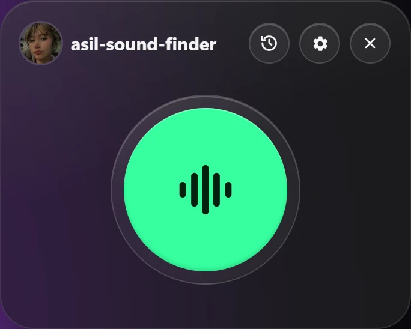
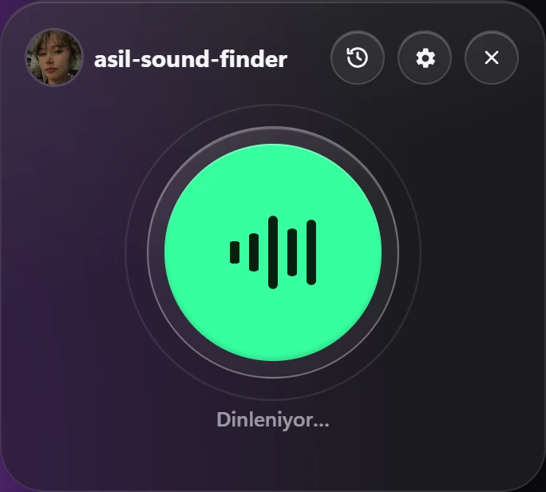
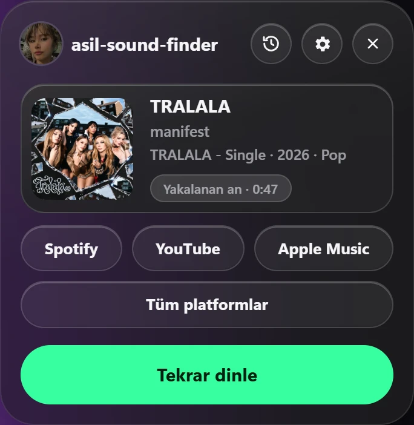
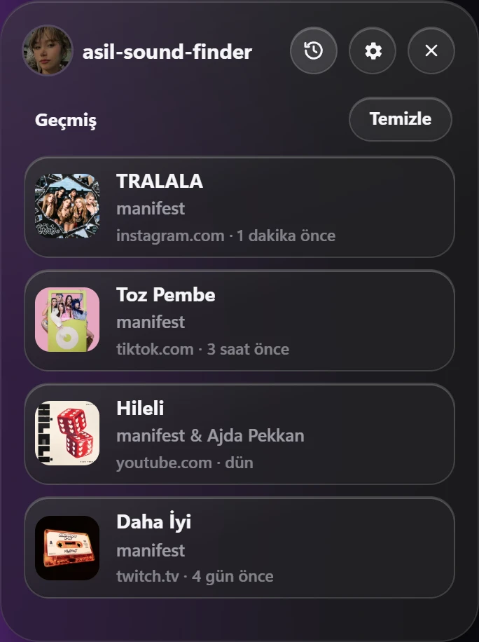
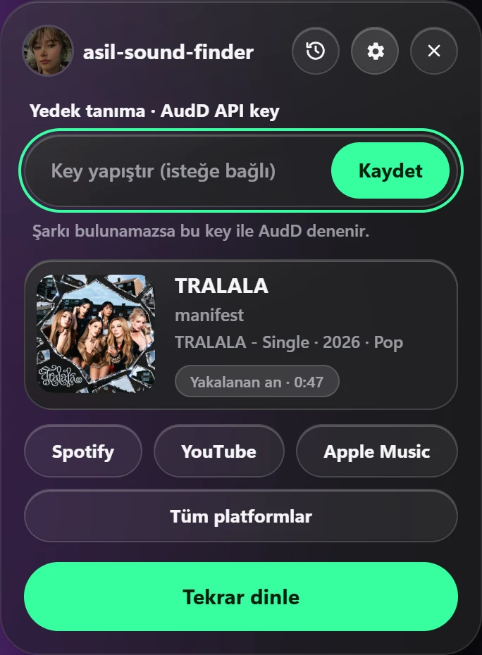
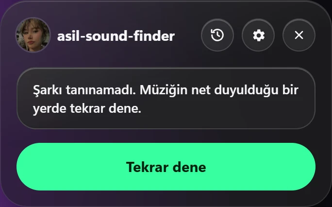

[Türkçe](#turkce) | [English](#english)

<a id="turkce"></a>

# asil-sound-finder

Tarayıcı sekmesinde çalan şarkıyı bulan bir Chrome eklentisidir. Instagram, TikTok, YouTube, Twitch ya da herhangi bir sitede arka planda çalan müziği dinler; şarkı adını, sanatçıyı, kapağı ve Spotify / YouTube / Apple Music bağlantılarını gösterir. Mikrofon kullanmaz, API anahtarı gerektirmez.

> **Önemli:** Şarkı tanıma, Shazam'ın resmi olmayan uç noktasıyla yapılır. Shazam bu yapıyı değiştirirse tanıma çalışmayı durdurabilir. Bu durumda ayarlardan isteğe bağlı bir AudD API anahtarı ekleyerek yedek tanımayı kullanabilirsiniz.

## Ekran görüntüleri

<table>
  <tr>
    <td align="center" valign="top" width="33%"><br /><sub>Dinlemeye hazır</sub></td>
    <td align="center" valign="top" width="33%"><br /><sub>Dinleniyor</sub></td>
    <td align="center" valign="top" width="33%"><br /><sub>Şarkı bulundu</sub></td>
  </tr>
  <tr>
    <td align="center" valign="top" width="33%"><br /><sub>Geçmiş</sub></td>
    <td align="center" valign="top" width="33%"><br /><sub>Yedek tanıma ayarı</sub></td>
    <td align="center" valign="top" width="33%"><br /><sub>Şarkı tanınamadı</sub></td>
  </tr>
</table>

## Nasıl çalışır?

- Eklenti simgesine tıklandığında sayfanın sağ üst köşesinde bir panel açılır. Büyük yuvarlak butona basınca dinleme başlar.
- Spotify Web, YouTube Music, Apple Music, SoundCloud, Deezer ve Tidal gibi müzik sitelerinde şarkı bilgisi doğrudan sayfadan okunur; ses kaydı yapılmaz.
- Diğer sitelerde sekmenin sesi `chrome.tabCapture` ile en fazla 12 saniye dinlenir. Sekmenin sesi bu sırada kesilmez.
- Ses 16 kHz mono'ya çevrilir ve [SongRec](https://github.com/marin-m/SongRec) algoritmasının JavaScript uyarlamasıyla bir ses parmak izi çıkarılır. Shazam'a sesin kendisi değil, yalnızca bu parmak izi gönderilir.
- Tanıma 4., 8. ve 12. saniyelerde denenir; şarkı bulunduğu anda dinleme durur.
- Sonuç ekranında şarkının albümü, yılı, türü ve şarkının hangi anında yakalandığı da gösterilir.
- Bulunan şarkılar geçmişe kaydedilir. Aynı şarkı tekrar bulunursa listede tekrarlanmaz, en üste taşınır.
- Sayfada sağ tıklayıp **asil-sound-finder ile şarkıyı bul** seçeneğiyle paneli açıp dinlemeyi doğrudan başlatabilirsiniz.
- Arayüz, bilgisayarın saat dilimi Türkiye ise Türkçe, değilse İngilizce açılır.

## Gereksinimler

- Google Chrome 116 veya üzeri. Edge, Brave ve Opera gibi Chromium tabanlı tarayıcılarda da çalışır.
- Ek kurulum veya API anahtarı gerekmez.

## Kurulum

1. Bu depoyu indirin (**Code → Download ZIP**) ve klasöre çıkarın ya da klonlayın:

   ```bash
   git clone https://github.com/asiltares/asil-sound-finder.git
   ```

2. Chrome'da `chrome://extensions` adresini açın.
3. Sağ üstteki **Geliştirici modu** anahtarını açın.
4. **Paketlenmemiş öğe yükle** butonuna tıklayın ve `manifest.json` dosyasının bulunduğu klasörü seçin.
5. Araç çubuğundaki yapboz simgesinden eklentiyi sabitleyin.

## Kullanım

1. Müzik çalan sekmeyi açın.
2. Araç çubuğundaki eklenti simgesine tıklayın.
3. Büyük yuvarlak butona basın ve birkaç saniye bekleyin.

| Buton | İşlev |
| --- | --- |
| Saat simgesi | Bulunan şarkıların geçmişini açar. Bir satıra tıklamak şarkıyı tekrar gösterir. |
| Çark simgesi | İsteğe bağlı AudD API anahtarı alanını açar. |
| Spotify / YouTube / Apple Music | Şarkıyı ilgili platformda açar. |
| Tüm platformlar | Şarkının diğer müzik platformlarındaki bağlantılarını açar. |
| Tekrar dinle | Yeni bir tanıma başlatır. |

Panel; dışına tıklanınca, `Esc` tuşuyla veya ✕ butonuyla kapanır.

## Gizlilik

- Shazam'a yalnızca ses parmak izi gönderilir; ses kaydı gönderilmez.
- AudD anahtarı eklediyseniz ve Shazam şarkıyı bulamazsa, kısa ses kaydı AudD'ye gönderilir.
- Geçmiş ve AudD anahtarı yalnızca tarayıcınızda (`chrome.storage.local`) saklanır.
- Dil seçimi için IP adresi kullanılmaz; bilgisayarın saat dilimine bakılır.

## İzinler

| İzin | Neden gerekli? |
| --- | --- |
| `tabCapture` | Sekmenin sesini dinlemek için. |
| `offscreen` | Sesi arka planda işlemek için. |
| `activeTab`, `scripting` | Paneli sayfaya eklemek ve müzik sitelerinden şarkı bilgisini okumak için. |
| `storage` | Geçmişi ve ayarları saklamak için. |
| `contextMenus` | Sağ tık menüsü için. |
| `declarativeNetRequest` | Shazam isteklerindeki `Origin` başlığını kaldırmak için. |

## Kaldırma

`chrome://extensions` sayfasında eklentiyi **Kaldır** butonuyla silin. Geçmiş ve ayarlar da birlikte silinir.

## Kapsam ve sınırlar

Tanıma, Shazam'ın veritabanında bulunan şarkılarla sınırlıdır. Canlı performanslar, ağır remiksler ve müziğin üzerinde yoğun konuşma olan videolar tanınmayabilir. `chrome://` sayfaları, yeni sekme sayfası, Chrome Web Store ve PDF görüntüleyici gibi eklentilerin erişemediği sayfalarda panel yerine standart açılır pencere kullanılır. DRM korumalı sitelerde (ör. Netflix) sekme sesi alınamayabilir.

---

<a id="english"></a>

# asil-sound-finder

A Chrome extension that identifies the song playing in a browser tab. It listens to music playing on Instagram, TikTok, YouTube, Twitch or any other site and shows the song title, artist, cover art and Spotify / YouTube / Apple Music links. It does not use the microphone and does not require an API key.

> **Important:** Song recognition uses Shazam's unofficial endpoint. If Shazam changes it, recognition may stop working. In that case, you can add an optional AudD API key in the settings to use backup recognition.

## Screenshots

<table>
  <tr>
    <td align="center" valign="top" width="33%"><br /><sub>Ready to listen</sub></td>
    <td align="center" valign="top" width="33%"><br /><sub>Listening</sub></td>
    <td align="center" valign="top" width="33%"><br /><sub>Song found</sub></td>
  </tr>
  <tr>
    <td align="center" valign="top" width="33%"><br /><sub>History</sub></td>
    <td align="center" valign="top" width="33%"><br /><sub>Backup recognition setting</sub></td>
    <td align="center" valign="top" width="33%"><br /><sub>Song not recognized</sub></td>
  </tr>
</table>

## How does it work?

- Clicking the extension icon opens a panel in the top-right corner of the page. Pressing the large round button starts listening.
- On music sites such as Spotify Web, YouTube Music, Apple Music, SoundCloud, Deezer and Tidal, the song information is read directly from the page; no audio is recorded.
- On other sites, the tab's audio is captured with `chrome.tabCapture` for up to 12 seconds. The tab keeps playing sound while this happens.
- The audio is converted to 16 kHz mono, and an audio fingerprint is generated with a JavaScript port of the [SongRec](https://github.com/marin-m/SongRec) algorithm. Only this fingerprint is sent to Shazam, not the audio itself.
- Recognition is attempted at 4, 8 and 12 seconds; listening stops as soon as the song is found.
- The result screen also shows the album, release year, genre and the moment in the song where it was caught.
- Found songs are saved to the history. If the same song is found again, it is moved to the top instead of being duplicated.
- Right-click on a page and choose **Find the song with asil-sound-finder** to open the panel and start listening right away.
- The interface opens in Turkish if the computer's time zone is set to Turkey, and in English otherwise.

## Requirements

- Google Chrome 116 or newer. It also works in Chromium-based browsers such as Edge, Brave and Opera.
- No additional installation or API key is required.

## Installation

1. Download this repository (**Code → Download ZIP**) and extract it, or clone it:

   ```bash
   git clone https://github.com/asiltares/asil-sound-finder.git
   ```

2. Open `chrome://extensions` in Chrome.
3. Turn on **Developer mode** in the top-right corner.
4. Click **Load unpacked** and select the folder that contains `manifest.json`.
5. Pin the extension from the puzzle icon in the toolbar.

## Usage

1. Open the tab where music is playing.
2. Click the extension icon in the toolbar.
3. Press the large round button and wait a few seconds.

| Button | Purpose |
| --- | --- |
| Clock icon | Opens the history of found songs. Click a row to show that song again. |
| Gear icon | Opens the optional AudD API key field. |
| Spotify / YouTube / Apple Music | Opens the song on that platform. |
| All platforms | Opens the song's links on other music platforms. |
| Listen again | Starts a new recognition. |

The panel closes when you click outside it, press `Esc`, or click the ✕ button.

## Privacy

- Only an audio fingerprint is sent to Shazam; no audio recording is sent.
- If you added an AudD key and Shazam cannot find the song, a short audio clip is sent to AudD.
- The history and the AudD key are stored only in your browser (`chrome.storage.local`).
- No IP address is used to pick the language; the computer's time zone is checked instead.

## Permissions

| Permission | Why is it needed? |
| --- | --- |
| `tabCapture` | To listen to the tab's audio. |
| `offscreen` | To process the audio in the background. |
| `activeTab`, `scripting` | To add the panel to the page and read song information from music sites. |
| `storage` | To store the history and settings. |
| `contextMenus` | For the right-click menu. |
| `declarativeNetRequest` | To remove the `Origin` header from Shazam requests. |

## Removal

Remove the extension with the **Remove** button on the `chrome://extensions` page. The history and settings are deleted along with it.

## Scope and limitations

Recognition is limited to songs in Shazam's database. Live performances, heavy remixes and videos with a lot of talking over the music may not be recognized. On pages that extensions cannot access, such as `chrome://` pages, the new tab page, the Chrome Web Store and the PDF viewer, the standard popup is used instead of the panel. Tab audio may not be capturable on DRM-protected sites (e.g. Netflix).

---

## License

[GPL-3.0](LICENSE). The audio fingerprint algorithm is a JavaScript port of [SongRec](https://github.com/marin-m/SongRec) (GPL-3.0). This project is not affiliated with Shazam, Apple, Spotify or YouTube.

If this project helped you, feel free to leave a ⭐.
